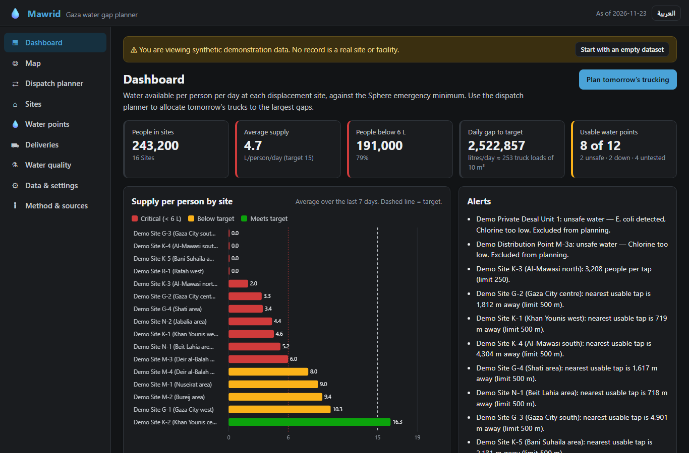
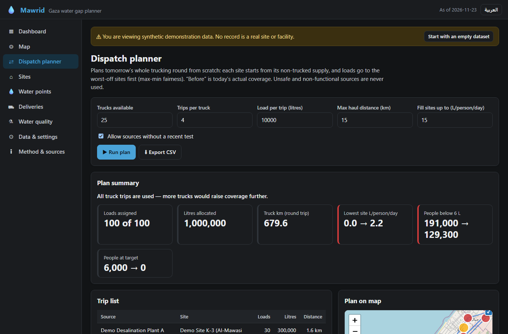
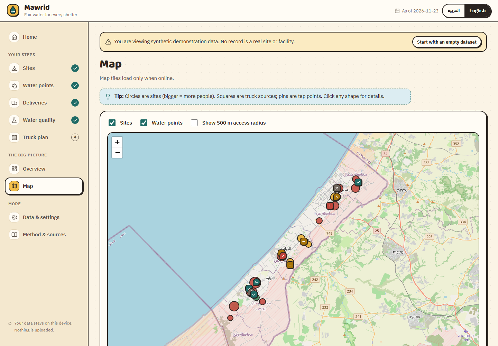
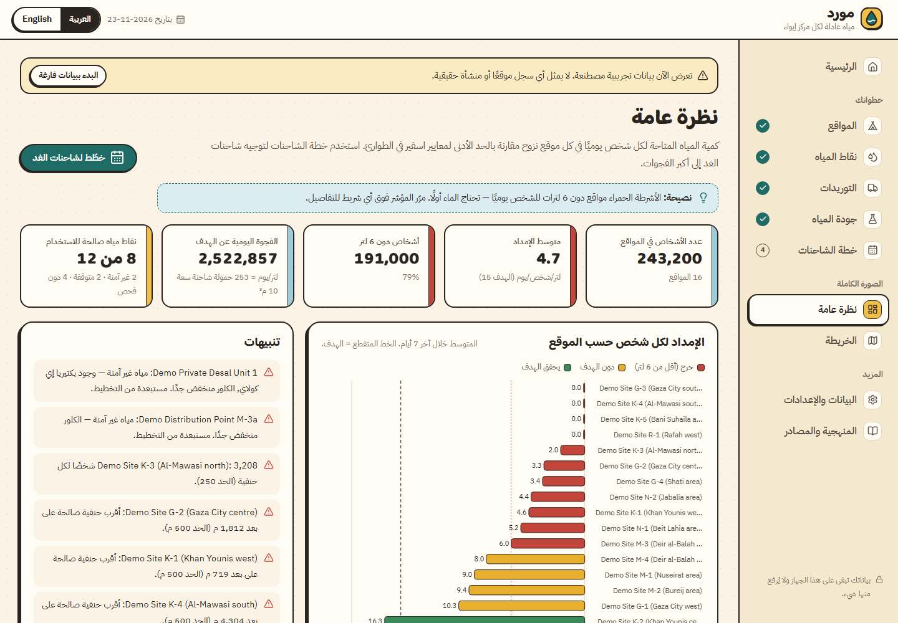

# Mawrid — Gaza Water Gap Planner · مورد

[](https://github.com/Mohammad-Abulibdeh/mawrid/actions/workflows/ci-deploy.yml)

**Live app: https://mohammad-abulibdeh.github.io/mawrid/**

An offline-first web app for WASH coordinators in the Gaza Strip. It shows how much water each
displacement site actually gets per person per day, flags unsafe water sources, and plans
tomorrow's water trucking so the worst-off sites are served first. English and Arabic (RTL).



## The problem

Average water availability in Gaza fell to roughly **4.5–6 litres per person per day** by late
March 2026 (OCHA via UNICEF), against a **15 L** emergency minimum (Sphere) and ~83 L before the
war (Oxfam). Most supply now arrives by **truck**, from a handful of working desalination plants,
wells and filling points. Because there is far less water than need, every truck load is a
decision — and those decisions are made with spreadsheets and phone calls, on intermittent
power and connectivity. Some sites get several trucks a day; neighbours get none.

Full research: [problem statement](docs/research/01-problem-statement.md) ·
[literature & standards review](docs/research/02-literature-review.md) ·
[sources](docs/research/03-sources.md)

## What it does

| Feature | Detail |
|---|---|
| **Coverage dashboard** | L/person/day per site (7-day average incl. zero days + non-trucked supply), population-weighted average, people below the 6 L critical floor, daily gap in litres and truck loads, alerts |
| **Dispatch planner** | Weighted max-min ("water-filling") allocation of truck loads: next load always goes to the site with the largest vulnerability-weighted shortfall, from the nearest safe source with water left, within a haul limit. Trip list, before/after per site, routes on a map, CSV export |
| **Water quality gate** | FRC (normal 0.2–0.5 / outbreak 0.5–1.0 mg/L, >5 toxic), turbidity (5 / 20 NTU), E. coli. Unsafe sources are excluded from access and planning everywhere |
| **Access check** | Distance from each site to the nearest usable tap (≤500 m), people per tap (≤250) |
| **Map** | Sites coloured by coverage band and sized by population; sources by status/quality; 500 m access radii; planned routes |
| **Registries & logs** | Sites, water points, deliveries, quality tests — validated forms, map location picker |
| **Data exchange** | JSON dataset and per-entity CSV import/export with row-level error reports; Excel-friendly UTF-8 |
| **Offline & private** | Service worker caches the app and viewed map tiles; all data stays in the browser; only site-level totals, no personal data |
| **Bilingual** | Full Arabic interface with right-to-left layout |

The bundled dataset is **synthetic demonstration data** (labelled in the app). See
[docs/data/README.md](docs/data/README.md).

## Screenshots

| Planner | Map | Arabic |
|---|---|---|
|  |  |  |

## Quick start

```bash
git clone https://github.com/Mohammad-Abulibdeh/mawrid.git
cd mawrid
npm ci
npm run dev     # → http://localhost:5173/mawrid/
npm run check   # lint + typecheck + tests + build
```

How to use it: [docs/USER_GUIDE.md](docs/USER_GUIDE.md) ·
Install & deploy: [docs/DEPLOYMENT.md](docs/DEPLOYMENT.md)

## Engineering

- **Stack:** React 18 + TypeScript (strict) + Vite, Leaflet/OpenStreetMap, hand-built SVG charts,
  Vitest + Testing Library. No backend: see the architecture decision in
  [docs/PROJECT_PLAN.md](docs/PROJECT_PLAN.md) and [docs/architecture.md](docs/architecture.md).
- **Domain engine** (`src/domain/`) is pure TypeScript, independent of the UI, with 99% line
  coverage.
- **Tests:** 55 automated tests (domain + UI workflows). Report: [docs/testing/TEST_REPORT.md](docs/testing/TEST_REPORT.md).
- **CI/CD:** GitHub Actions runs lint, typecheck, tests with coverage and build on every push and
  PR; `main` deploys to GitHub Pages and is smoke-tested.

```
src/
  domain/      types, analytics, quality, planner, validate, csv, io, seed (pure, tested)
  state/       store (reducer + localStorage persistence)
  i18n/        English/Arabic strings, RTL
  components/  charts, map, form fields, badges, error boundary
  pages/       Dashboard, Map, Planner, Sites, Points, Deliveries, Quality, Data, About
tests/         domain/*.test.ts, ui/app.test.tsx
public/        service worker, manifest, icon
docs/          research, architecture, data schema, testing, deployment, user guide
```

## Status

| | |
|---|---|
| Implemented | Everything in the feature table above |
| Tested | Domain engine (unit), main UI workflows (integration), live site (manual) — see test report |
| Deployed | https://mohammad-abulibdeh.github.io/mawrid/ via GitHub Actions |
| Planned | See [ROADMAP.md](ROADMAP.md) — multi-device sync, fuel constraints, truck-level routing, field validation with WASH partners |

Progress log: [DEVELOPMENT_LOG.md](DEVELOPMENT_LOG.md) · Changes: [CHANGELOG.md](CHANGELOG.md)

## Limitations

Mawrid does not create water. The binding constraints in Gaza are fuel, spare parts, access and
safety. The tool helps allocate the volume that *is* available more fairly and transparently. It
has not yet been validated with WASH Cluster partners in the field; distances are straight-line,
not road distances; and the planner does not model fuel, truck shifts or access restrictions.

## License

MIT — see [LICENSE](LICENSE). Map data © OpenStreetMap contributors.
