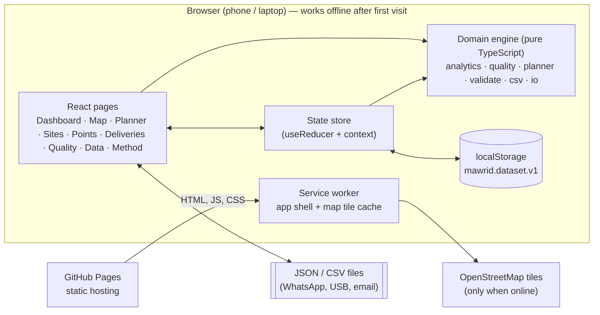
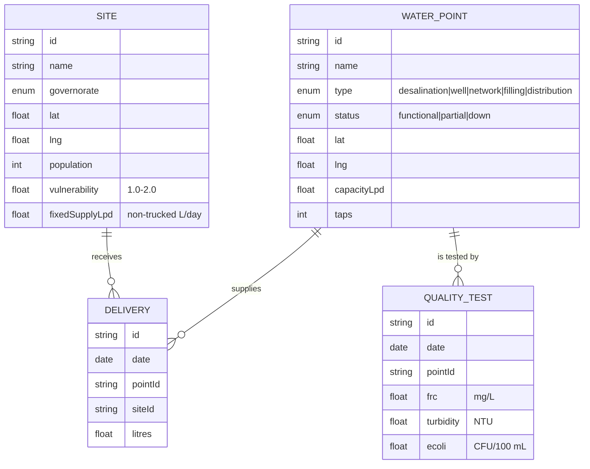
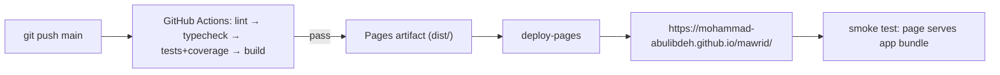

# Architecture

## Overview

There is no application server and no database server. This is deliberate (see ADR-001 in
[PROJECT_PLAN.md](PROJECT_PLAN.md)): field connectivity is intermittent, and a central store of
site locations in an active conflict concentrates sensitive data.

## Layers

| Layer | Path | Responsibility | Depends on |
|---|---|---|---|
| Domain | `src/domain/` | Data model, standards, calculations, planner, validation, CSV | nothing (pure functions) |
| State | `src/state/store.tsx` | Single dataset in a reducer; persistence; derived metrics | domain |
| i18n | `src/i18n/` | English/Arabic strings, RTL direction, number formatting | — |
| Components | `src/components/` | Charts (SVG), map (Leaflet), badges, form fields, error boundary | domain, i18n |
| Pages | `src/pages/` | One route each; user workflows | all of the above |
| PWA | `public/sw.js`, `public/manifest.webmanifest` | Offline shell, tile cache, installability | — |

The domain layer has no React or browser imports, so it is fully unit-tested and could be
reused unchanged by a future sync server (e.g. FastAPI or a Supabase edge function).

## Data model

The full dataset is one JSON document (`schemaVersion: 1`) — see
[data/schema.json](data/schema.json). Imports are validated record by record; invalid records are
dropped and reported, never silently kept.

## Key flows

**Coverage.** `computeSiteMetrics(dataset, refDate)`
→ per site: average trucked L/day over the window + fixed supply → L/person/day → band
(critical / below / meets) → nearest usable tap distance → people per tap → priority score.

**Quality gate.** `pointQuality()` takes the latest test within `testMaxAgeDays`; `unsafe`
points are excluded from access calculations and from the planner everywhere.

**Dispatch plan.** `planDispatch(dataset, refDate, params)` — discrete weighted max-min
allocation, documented in [research/02-literature-review.md](research/02-literature-review.md#3-allocation-method).

## Deployment

Pull requests run the same checks but do not deploy.
